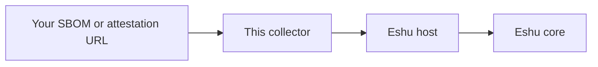

# eshu-collector-sbom-attestation

Status: pre-release. Please don't rely on it in production yet.

Eshu keeps track of what your software is made of, and this little helper reads the paperwork. You point it at one SBOM or attestation document, it fetches and parses that document, and it hands Eshu a tidy, checked summary of what's inside. It only ever reads. Creating or signing documents isn't its job.

What you get:

- CycloneDX and SPDX SBOMs turned into parts, dependency links, and outside references
- in-toto attestations, including SLSA build history and signature check results
- Warnings as facts, so one messy corner of a document doesn't sink the whole read
- Every fact labelled with where it came from, at confidence `reported`
- No database access at all. Eshu's host checks and stores everything

Reach for it when the documents already exist at known web addresses and you want Eshu to read them on its own schedule. Skip it if you need to build an SBOM from scratch, sign something, or hunt for documents attached to container images.

## How Eshu runs it

The host starts the program for one claim at a time.
It sends one bounded `collector-sdk/v1alpha1` request on stdin and reads one result from stdout.
The collector fetches just the one document the claim names.
Then the host validates the result and commits it, and the collector exits having stored nothing itself.

In other words, there's no long-running service to babysit here.
You enable it, Eshu calls it claim by claim, and each call either
comes back with checked facts or with a plain explanation of why not.
If that loop is new to you, the concepts page in the table below
walks through one claim from start to finish.

## Documentation

Start at the [documentation index](docs/README.md) if you'd like a map, or jump straight to what you need:

| Guide | What you will find |
| --- | --- |
| [Getting started](docs/getting-started/README.md) | The fastest honest path from a fresh checkout to something working |
| [Concepts](docs/concepts/README.md) | What it collects, how a claim plays out, and a worked example from the fixtures |
| [Guides](docs/guides/README.md) | Seeding, operating, and troubleshooting, plus how releases work |
| [Configuration reference](docs/reference/configuration.md) | Every config key, credentials, and the size limits |
| [Fact kinds reference](docs/reference/facts.md) | Every fact kind it can return, mirroring the manifest |
| [Architecture](docs/architecture/README.md) | Where it sits inside Eshu, what it's made of, and the versions it pins |
| [Diagrams](docs/diagrams/README.md) | System context, claim lifecycle, and deployment, each with a text version |
| [Examples](examples/README.md) | The real sample files in this repo and what each one is for |

## Related projects

- [Eshu core](https://github.com/eshu-hq/eshu) runs this collector and owns the final say on what's stored.
- [eshu-sdk](https://github.com/eshu-hq/eshu-sdk) holds the shared collector and fact-schema modules.
- [eshu-deploy](https://github.com/eshu-hq/eshu-deploy) has deployment examples you can copy from.

## Development

Run `make ci` and you're running the same lint, test, and race checks that CI runs.
The [contributing guide](docs/contributing/README.md) covers setup in a bit more detail,
including the tools you'll want installed first.

## Contributing, security, and license

Contributions are welcome. Please read [CONTRIBUTING.md](CONTRIBUTING.md) first, and keep credentials as environment references, never inline values. If you spot a security issue, please don't file it as a public issue. Reach the maintainers privately so a fix can land before details circulate. This project is MIT licensed. See [LICENSE](LICENSE).
